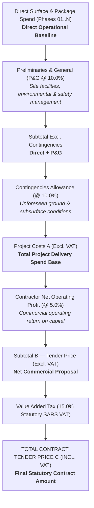

# Mining & Heavy Industrial Decommissioning, Environmental Rehabilitation & Costing Automation Engine

[](https://www.python.org/downloads/)
[](https://openpyxl.readthedocs.io/)
[](#financial-waterfall-architecture)
[](#automated-audit--quality-assurance)
[](LICENSE)
[](.github/)

Professional engineering and commercial costing suite developed for **Sankofa Digital Studio** and **Senatla Trading Enterprise**. Automates the complete financial, civil engineering, and operational budgeting modeling for large-scale mining asset decommissioning, deep shaft geotechnical backfilling, structural steel demolition, and surface rehabilitation projects.

---

## Executive Overview

This repository provides production-grade model generation scripts that construct multi-sheet executive financial workbooks adhering to South African mining engineering and commercial standards (JBCC / FIDIC / NEC compliant costing structures).

### Core Project Models Included

1. **CAPM Tau Mine #10 Decommissioning & Deep Shaft Backfilling Model**
   - **Footprint**: 1,463,268 m² (146.33 Hectares) across 8 surface zones.
   - **Shaft Backfill**: 1,538,058 Tonnes (904,740 m³ bulk in situ) backfilled to 1,774 meters below collar.
   - **Shaft Capping**: 680 m³ 40 MPa high-strength certified reinforced concrete slabs.
   - **Total Tender Value**: **R 308,152,929.16** (incl. 15% VAT, 24-month program).
   - **Workbook**: [`CAPM_Tau_Mine_10_Demolition_Rehabilitation_Model.xlsx`](CAPM_Tau_Mine_10_Demolition_Rehabilitation_Model.xlsx) (15 Sheets, 798 formulas, 0 errors).

2. **West Gold Plant Demolition & Rehabilitation Model**
   - **Footprint**: Comprehensive processing plant demolition across 7 operational phases (Smelt House, Thickener Dams, Mill Section, Silos & Foundations, Workshops, Overland Conveyors, Main Gate).
   - **Total Tender Value**: **R 26,810,141.82** (incl. 15% VAT, 12-month program).
   - **Workbook**: [`West_Gold_Plant_Demolition_Rehabilitation_Model.xlsx`](West_Gold_Plant_Demolition_Rehabilitation_Model.xlsx) (13 Sheets, 202 formulas, 0 errors).

3. **Senatla 5-Village Municipal Demolition & Rubble Haulage Model**
   - **Scope**: Five municipal village residential and civil structure demolition zones (Boiketlong, Polokong, Woolaways, Jabulani, Pabalong).
   - **Total Tender Value**: **R 3,036,055.41** (incl. 15% VAT, 6-month program).
   - **Workbook**: [`Senatla_5_Village_Demolition_Rehabilitation_Model.xlsx`](Senatla_5_Village_Demolition_Rehabilitation_Model.xlsx) (8 Sheets, 157 formulas, 0 errors).

4. **Universal Parameterized Costing Generator**
   - CLI-driven model builder accepting arbitrary JSON/dictionary configurations for any new industrial site, mine, or village.

---

## Financial Waterfall Architecture

Every workbook and model strictly calculates the commercial pricing waterfall using 100% dynamic uppercase Excel formulas:



### Monthly Run-Rate & S-Curve Distribution
- **Monthly Run-Rate**:
  $$\text{Run-Rate} = \frac{\text{Project Costs A}}{\text{Contract Duration (Months)}}$$
- **Phased S-Curve Forecast**: Models the bell-curve capital expenditure distribution across contract quarters with cumulative cash flows.

---

## Repository Structure

```
├── .github/
│   ├── ISSUE_TEMPLATE/
│   │   ├── bug_report.md             # Issue template for formula or workbook bugs
│   │   ├── feature_request.md        # Feature request for new phase/rate templates
│   │   └── config.yml                # Issue configuration
│   ├── workflows/
│   │   └── ci.yml                    # Automated GitHub Actions test workflow
│   └── PULL_REQUEST_TEMPLATE.md      # Structured PR checklist and quality rubric
├── build_universal_costing_model.py  # Universal generator for any mine / plant / village
├── build_capm_tau_mine_workbook.py   # Specialized generator for CAPM Tau Mine #10
├── build_west_gold_workbook.py       # Specialized generator for West Gold Plant
├── verify_universal_model.py         # Automated formula audit tool (0 errors verification)
├── verify_capm_tau_model.py          # CAPM Tau Mine model auditor
├── verify_model.py                   # West Gold Plant model auditor
├── CAPM Tau Mine 10# Scope of work 1.docx # Source contract specifications
├── CAPM Tau Mine 10# Site map.docx        # Surveyed aerial boundary specifications
├── capm_tau_sitemap_0.png            # Surveyed aerial site map graphic
├── CAPM_Tau_Mine_10_Demolition_Rehabilitation_Model.xlsx
├── West_Gold_Plant_Demolition_Rehabilitation_Model.xlsx
├── Senatla_5_Village_Demolition_Rehabilitation_Model.xlsx
├── requirements.txt                  # Python runtime dependencies
├── .gitattributes                    # Binary and line-ending definitions
├── .gitignore                        # Git exclusion rules
├── LICENSE                           # Apache 2.0 open-source license
├── CONTRIBUTING.md                   # Engineering standards & contribution guidelines
├── CODE_OF_CONDUCT.md                # Contributor Covenant v2.1
├── SECURITY.md                       # Vulnerability disclosure & security policy
└── SUPPORT.md                        # Support & technical advisory channels
```

---

## Quickstart & Installation

### 1. Clone Repository
```bash
git clone https://github.com/Sankofa-Digital-Studio/west-gold.git
cd west-gold
```

### 2. Environment Setup
```bash
python -m venv .venv
# On Windows:
.venv\Scripts\activate
# On Linux/macOS:
source .venv/bin/activate

pip install -r requirements.txt
```

---

## Usage

### Generate Pre-configured Models

```bash
# Build Senatla 5-Village Municipal Model
python build_universal_costing_model.py --preset village

# Build West Gold Plant Model
python build_universal_costing_model.py --preset westgold

# Build CAPM Tau Mine #10 Model
python build_capm_tau_mine_workbook.py
```

### Generate Custom Project Models from JSON
Define your project scope in a JSON configuration file:

```json
{
  "project_name": "Klipfontein Processing Facility Demolition",
  "client_name": "Klipfontein Mining Assets (Pty) Ltd",
  "contract_ref": "KPF-DEMO-2027",
  "duration_months": 18,
  "output_filename": "Klipfontein_Demolition_Model.xlsx",
  "rates": {
    "site_est": 35000.0,
    "steel_dismantle": 21000.0,
    "concrete_breakup": 240.0,
    "rubble_haul": 120.0,
    "shaping_levelling": 18.50,
    "pg_pct": 0.10,
    "contingency_pct": 0.10,
    "profit_pct": 0.05,
    "vat_pct": 0.15
  },
  "phases": [
    {"name": "Zone A - Primary Crusher", "footprint_m2": 45000, "structures": 4, "concrete_m3": 3200, "duration_months": 4},
    {"name": "Zone B - Flotation Circuit", "footprint_m2": 62000, "structures": 6, "concrete_m3": 5100, "duration_months": 6}
  ]
}
```

Run the generator:
```bash
python build_universal_costing_model.py --config my_project.json
```

---

## Automated Audit & Quality Assurance

Every generated workbook must pass automated validation before client submission:

```bash
python verify_universal_model.py Senatla_5_Village_Demolition_Rehabilitation_Model.xlsx
```

**Audit Output Guarantee:**
```
--- Auditing Workbook: Senatla_5_Village_Demolition_Rehabilitation_Model.xlsx ---
Sheets (8): ['Rates & Parameters', 'Master BOQ Breakdown', 'Executive Summary & Financials', 'Boiketlong Village', 'Polokong Village', 'Woolaways Village', 'Jabulani Village', 'Pabalong Village']
  * Sheet 'Rates & Parameters': 0 formulas, errors = 0
  * Sheet 'Master BOQ Breakdown': 55 formulas, errors = 0
  * Sheet 'Executive Summary & Financials': 47 formulas, errors = 0
  * Sheet 'Boiketlong Village': 11 formulas, errors = 0
  * Sheet 'Polokong Village': 11 formulas, errors = 0
  * Sheet 'Woolaways Village': 11 formulas, errors = 0
  * Sheet 'Jabulani Village': 11 formulas, errors = 0
  * Sheet 'Pabalong Village': 11 formulas, errors = 0

Result: Total Formulas = 157, #REF! = 0, #VALUE! = 0, #NAME? = 0
>>> SUCCESS: 100% VALIDATED WITH ZERO FORMULA ERRORS!
```

---

## Community Standards & Contributing

We welcome contributions! Please review our community standard documents:
- [Contributing Guidelines](CONTRIBUTING.md)
- [Code of Conduct](CODE_OF_CONDUCT.md)
- [Security Policy](SECURITY.md)
- [Support Information](SUPPORT.md)

---

## License

This project is licensed under the **Apache License 2.0** — see the [LICENSE](LICENSE) file for details.

Copyright &copy; 2026 **Sankofa Digital Studio** &amp; **Senatla Trading Enterprise**. All rights reserved.
